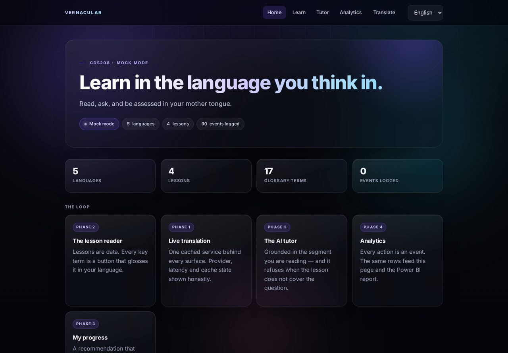
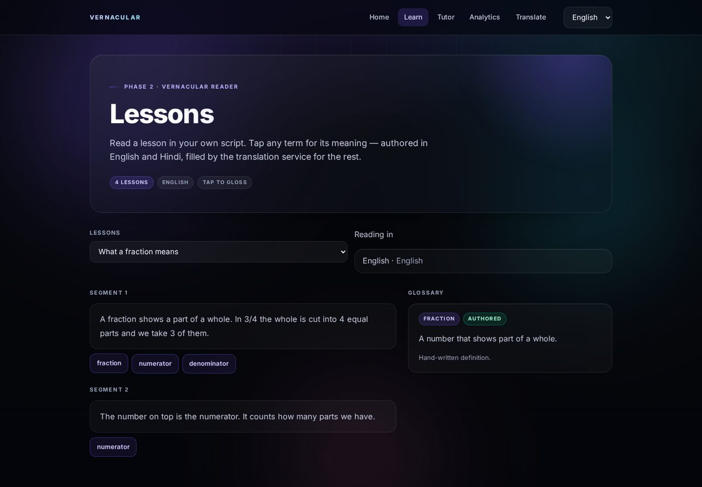
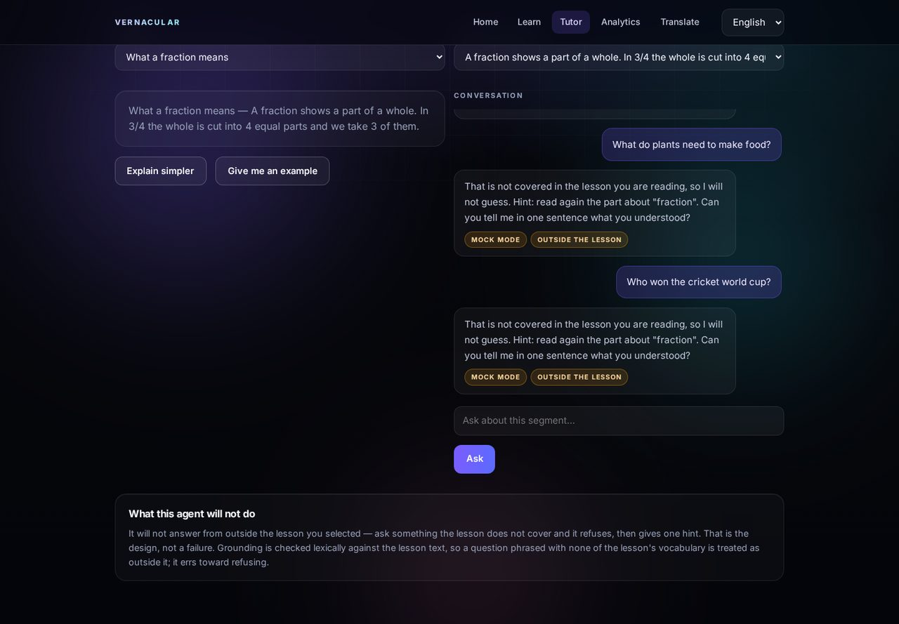

# Vernacular Education & Real-Time Translation Platform

A learning platform where a student reads a lesson in their mother tongue, taps any
term for an instant gloss, asks an AI tutor that answers in that language without
inventing facts, and is assessed on it — while every one of those actions becomes a
row in an event log a teacher can read in Power BI.

**CDS208 final project.** FastAPI backend over a plain-Python service layer, and a
vanilla HTML/CSS/JS frontend with no build step. Sarvam AI when a key is present,
a labelled offline mock when it is not — so the demo cannot be broken by Wi-Fi.




## Why this stack

The services (`core/`, `agents/`) are framework-free Python: they take plain
arguments and return plain dicts. That is deliberate — the first version of this
project shipped on Streamlit, and when the frontend was rewritten in HTML/CSS/JS
**not one line of the service layer changed**. The pages went; the brain stayed.

FastAPI exposes those services as JSON, and the frontend is static files served by
the same process: no Node, no bundler, no CORS problems, one `uvicorn` command.

## Run it

```bash
git clone https://github.com/bhavyanpotla/cds208-vernacular-web.git
cd cds208-vernacular-web
python -m venv .venv && source .venv/bin/activate     # Windows: .venv\Scripts\activate
pip install -r requirements.txt
python scripts/seed_demo.py --reset                   # optional: fill the dashboard
uvicorn api.main:app --reload --port 8000
```

Open <http://127.0.0.1:8000/>.

No `.env` needed. With no `SARVAM_API_KEY` the header shows **Mock mode** and every
AI path returns a visibly labelled mock result.

To use the real provider:

```bash
cp .env.example .env    # put your key in SARVAM_API_KEY
```

What changes: translations come from Sarvam `mayura:v1`, the tutor answers via
`sarvam-m`. Nothing else — no page code changes.

## The five surfaces

| Page | What it does |
|---|---|
| `index.html` | The loop, the runtime state, and honest numbers |
| `learn.html` | Lesson segments in the learner's script; every key term glosses in place, labelled *authored* or *translated*; quiz with per-question explanations |
| `translate.html` | Two-panel workspace with provider badge, latency in ms, cache state, recent translations |
| `tutor.html` | Grounded chat — answers from the selected segment, **refuses** when the lesson does not cover the question |
| `analytics.html` | Live metrics, DAU sparkline, language mix, struggle list, one-click Power BI export |




## API

| Method | Route | Purpose |
|---|---|---|
| GET | `/api/health` | mode, counts — the frontend's first call |
| GET | `/api/languages` | registry with native names and scripts |
| GET | `/api/ui-strings?lang=` | UI string table for the chosen language |
| GET | `/api/lessons?lang=` | lesson list, localised |
| GET | `/api/lessons/{id}?lang=` | segments + terms + quiz (answers withheld) |
| POST | `/api/gloss` | term → meaning + provenance |
| POST | `/api/translate` | the cached translation service |
| POST | `/api/tutor` | grounded answer or honest refusal |
| POST | `/api/quiz` | score, record progress, return explanations |
| GET | `/api/progress`, `/api/recommend` | rule-first personalisation |
| GET | `/api/analytics`, POST `/api/export` | dashboard numbers, CSV export |

Interactive docs at `/docs` (FastAPI's OpenAPI UI) — useful in the viva.

## Architecture

```
web/*.html + assets/app.{css,js}     ← static, no build step
        │  fetch JSON
api/main.py (FastAPI)                ← routes, request context, static mount
        │  plain Python calls
core/  agents/                       ← framework-free services
        │
core/db.py → SQLite                  ← events are append-only
        │
core/export.py → exports/*.csv → Power BI
```

Two rules: services never import a web framework, and pages never talk to the
provider directly. Both are enforced by the test suite, not by good intentions.

## Content and languages

Four lessons (three science, one maths), 13 segments, 12 quiz questions, 17 glossary
terms. English and Hindi are hand-authored; Tamil, Telugu and Bengali are a content
gap the translation service closes on first read and caches in SQLite — which is why
the gloss card tells you whether a definition was authored or translated.

## Translation matrix and voice

`/matrix.html` — five languages, all twenty ordered directions, in and out.

| Layer | How it works |
|---|---|
| Text | Sarvam `mayura:v1` for any pair (hi, ta, te, en, bn), cached, with provider and latency shown |
| Speech in | Sarvam `saaras:v3` when a key is present; the browser's `SpeechRecognition` otherwise, labelled as cloud-hosted |
| Speech out | Sarvam `bulbul:v3` with three voices — Anushka, Shubh, Aditya — selected per session |
| No key | Labelled mock: text falls back to the mock translator, speech falls back to the browser's `speechSynthesis` and says so |

Endpoints: `GET /api/voice/voices`, `POST /api/voice/tts`, `POST /api/voice/stt`.

A rejected speaker name is retried once with the documented default rather than
failing the request, because Sarvam speaker IDs are case-sensitive and
model-specific.

## Language bridge (Hindi → Mundari)

`core/bridge.py` answers in tiers and says which tier answered:

| tier | source | confidence |
|---|---|---|
| 1 `authored` | a hand-written classroom phrase, verified or draft | 0.98 verified · 0.60 draft |
| 2 `corpus` | exact match in the parallel corpus | 0.85 |
| 3 `approximate` | best partial overlap in the corpus, labelled with the overlap % | 0.40 + 0.35 × overlap |
| 4 `none` | no match — refuses instead of inventing | 0.00 |

The corpus is general-domain (news, legal, administrative): only ~5.8% of its
17,729 rows touch classroom vocabulary, so tier 1 is what makes the product
usable and the corpus is the fallback, not the engine. `data/classroom_targets.tsv`
is a 30-row list of real classroom instructions waiting for Mundari — fill it and
the authored tier starts answering.

Endpoints: `POST /api/bridge` and `GET /api/bridge/stats`. Coverage counts are
printed, never rounded up: `0 verified classroom phrases · 17729 corpus sentences
(unverified)` is the honest current state.

Tooling: `scripts/build_corpus.py` normalises a raw parallel TSV into the
nine-column schema, `scripts/validate_corpus.py` checks it (exit 0/1), and
`scripts/bench_bridge.py` prints tier distribution and latency. Provenance, licence
status and every dropped row are documented in `docs/corpus-provenance.md`.

## Analytics

Every action appends to `events`. `analytics.html` queries that table, and
**Refresh export** writes `fact_events.csv`, `fact_translations.csv`,
`dim_lessons.csv`, `dim_users.csv` and `_health.json` into `exports/`. Power BI reads
the folder; the full model, DAX measures and three-page report are documented in
[`docs/powerbi.md`](docs/powerbi.md).

`_health.json` carries row counts, null rates, cache hit rate and the list of
documented events that have **never fired** — the coverage audit that catches a
feature nobody instrumented.

## Tests

```bash
pip install ruff pytest httpx
ruff check .
python -m pytest
```

83 tests, no network and no API key required: the mock contract, cache layers,
lesson localisation, quiz scoring, the tutor's refusal rule, the recommender's
fallbacks, the export pipeline, the i18n completeness rule (every key in every
language, each Indic string in its own Unicode range), and the HTTP contract the
frontend depends on.

## Project layout

```
api/main.py            FastAPI routes + static mount
api/context.py         per-request session/learner context
core/config.py         the only module that reads the environment
core/db.py             SQLite schema; the Postgres swap lives here
core/events.py         log_event() — append-only analytics source of truth
core/llm.py            provider adapter: sarvam | mock, retries, chunking
core/translate.py      memory cache → SQLite → provider → event
core/lessons.py        load/localise lessons and glossary
core/quiz.py           pure scoring + progress/event recording
core/export.py         four CSVs + health file, plus chart queries
core/i18n.py           UI strings in five languages
agents/prompts.py      every system prompt, one place
agents/tutor.py        grounded answers + honest refusal, offline and live
agents/coach.py        rule-first recommender; the model only phrases the reason
agents/phrases.py      offline phrasing in all five languages
web/                   index, learn, translate, tutor, analytics + assets
content/               lessons and glossary as data
scripts/seed_demo.py   fills a fresh deployment with plausible activity
docs/                  powerbi.md, screenshots
```

## Limitations

- **Four lessons, not a curriculum** — a demonstration of the loop.
- **No speech (STT/TTS)** — the text path is the product; speech is roadmap.
- **Tutor grounding is lexical, not semantic** — a question with none of the lesson's vocabulary is treated as outside it. It errs toward refusing.
- **Mock mode is not a model** — deterministic and labelled; dashboard numbers are real, translated text is not.
- **Single local learner** — the `users` table is ready for auth; there is none yet.
- **SQLite is a single file** — fine for a demo, one file to change for Postgres.

## License

Academic project — CDS208 coursework.
